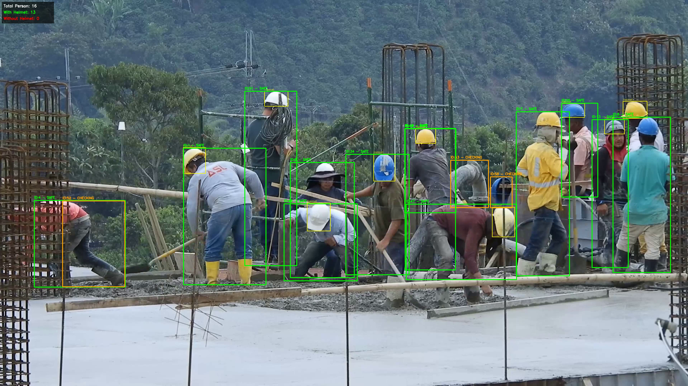
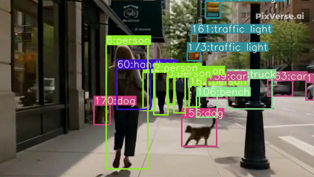
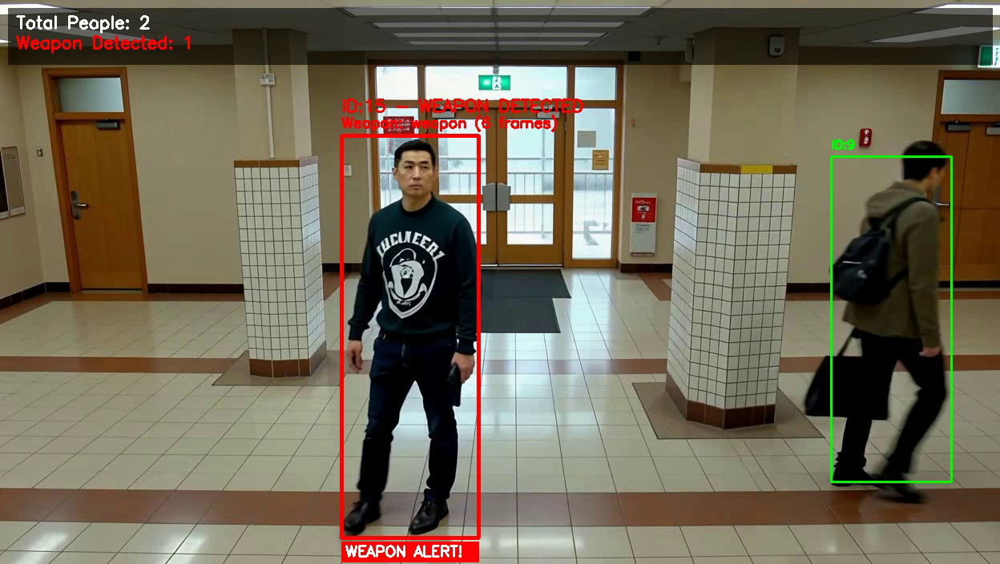
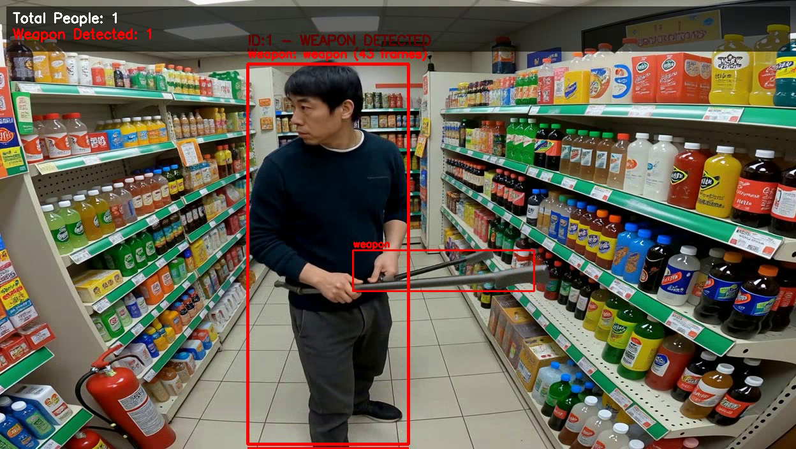
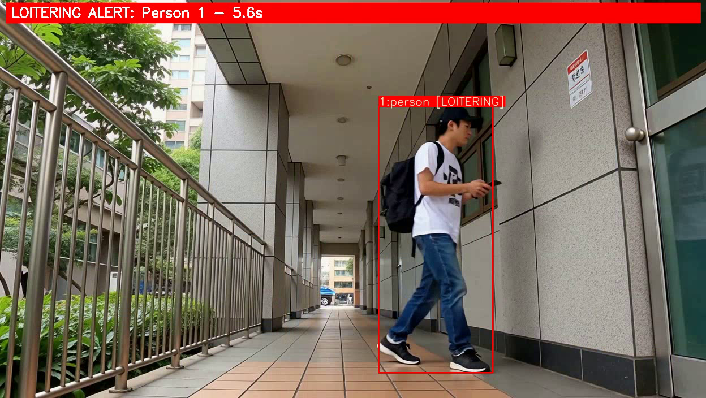
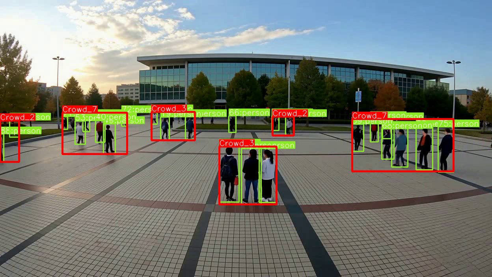

# Workplace Safety Vision: PPE Compliance, Fall Detection and Threat Detection at the Edge

[](https://onnxruntime.ai/)
[](https://ultralytics.com/)
[](https://github.com)
[](https://opensource.org/licenses/MIT)

A high-throughput edge computer vision framework designed for industrial health & safety (HSE), personal protective equipment (PPE) compliance, fall event alerts, and physical security threat detection.

---

## System Capabilities & Detections

### 1. Construction Site PPE & Helmet Live Compliance
Simultaneous multi-worker detection tracking Helmet and Safety Vest compliance with live counter overlays.


### 2. Real-Time Human Fall Detection
Instant alert triggering upon rapid vertical velocity and aspect-ratio collapse.


### 3. Active Threat & Weapon Identification
Sub-second detection of firearms and bladed weapons in indoor and retail environments.



### 4. Dwell Time & Loitering Alerts
Zone intrusion and loitering tracking with duration counters.


### 5. Crowd Density Estimation
Spatial clustering algorithm estimating pedestrian volume and gathering alerts.


---

## Core Capabilities

### 1. PPE Spatial Intersection Attribution
Rather than just detecting loose helmets, the system implements an IoU and centroid containment algorithm (`is_ppe_on_person`):
$$\text{Intersection}(B_{\text{person}}, B_{\text{gear}}) > 0 \quad \land \quad C_{\text{gear}} \in B_{\text{person}}$$
Accurately maps helmets and vests to unique person track IDs to generate compliant vs non-compliant audit numbers.

### 2. Human Fall Event Trigger
Monitors bounding box bounding geometry:
- Aspect ratio inversion: $\frac{\text{Width}}{\text{Height}} > 1.2$
- Vertical centroid acceleration: $\frac{\Delta C_y}{\Delta t} > V_{\text{thresh}}$
- Ground proximity validation to eliminate false positives from sitting or tying shoelaces.

### 3. Edge-Optimized ONNX Runtime Inference
Optimized with FP16 precision via ONNX Runtime GPU, for efficient edge deployment.

---

## Quickstart

```bash
# Clone the repository
git clone https://github.com/mh-masum6875/workplace-safety-edge-vision.git
cd workplace-safety-edge-vision

# Install dependencies
pip install -r requirements.txt
```

### Running PPE Compliance Detection:
```bash
python src/ppe_compliance_tracker.py --source data/construction_site.mp4
```

### Running Fall Detection (ONNX GPU):
```bash
python src/fall_detection_onnx.py --source data/workplace_feed.mp4 --weights models/fall_detection.onnx
```

### Running Weapon Detection:
```bash
python src/weapon_detection_onnx.py --source data/security_feed.mp4 --weights models/weapon_detection.onnx
```

---


---

## Related Analytics

Beyond the open-source sample modules provided in this repository, the underlying algorithmic framework has been architected, validated, and deployed across **25+ specialized industrial safety and physical security analytics**:

### 1. Worker PPE & Personal Compliance
- **Full PPE Spatial Attribution**: Simultaneous detection and spatial IoU mapping of Helmets, Safety Vests, and Persons.
- **Headwear Compliance**: Specialized Cap and Hairnet detection algorithms.
- **Respiratory Health**: Face mask usage monitoring in sterile and high-dust zones.
- **Access & Identity Verification**: Automated ID card, lanyard, and worker badge localization.
- **Uniform Compliance**: Automated detection of organizational dress codes, hi-vis jackets, and protective footwear.
- **Station Availability**: Dwell-time monitoring for machine operators and guard presence verification.

### 2. Heavy Machinery & Critical Danger Zones
- **Working at Heights**: Detection of elevated workers, ladder usage, and harness lanyard tethering verification.
- **Crane Operational Zone Breaches**: Dynamic exclusion polygons warning personnel entering active crane swing radiuses.
- **Forklift-Pedestrian Collision Prevention**: Real-time proximity calculation between mobile machinery and foot traffic.
- **Worker Fatigue & Drowsiness**: Posture-based drowsiness, prolonged head dropping, and worker idle timeout detection.

### 3. Physical Security & Threat Interception
- **Perimeter Intrusion & Wall Climbing**: Multi-point tripwire and polygon intrusion detection with height-scaling.
- **Camera Tampering Detection**: Real-time alerting for lens spraying, physical covering, camera displacement, and blinding.
- **Projectile & Stone Throwing**: Rapid arm trajectory tracking and thrown object vector detection.
- **Physical Altercation & Violence**: Interaction bounding box overlap and chaotic movement analysis for fight detection.
- **Self-Harm & Incident Alerting**: Bounding-box aspect ratio inversion and suspension tracking for emergency alerts.

### 4. Facility Crowd Dynamics & Emergency Egress
- **Bi-Directional Access Counting**: Line-crossing counting for facility entry/exit audit trails.
- **Crowd Congestion & Spatial Heatmaps**: Density gradient calculation highlighting bottleneck corridors in real-time.
- **Emergency Egress Obstruction**: Automated alerts when emergency exits, fire doors, or escape stairs are blocked by objects or personnel.

## License
This project is licensed under the MIT License.
